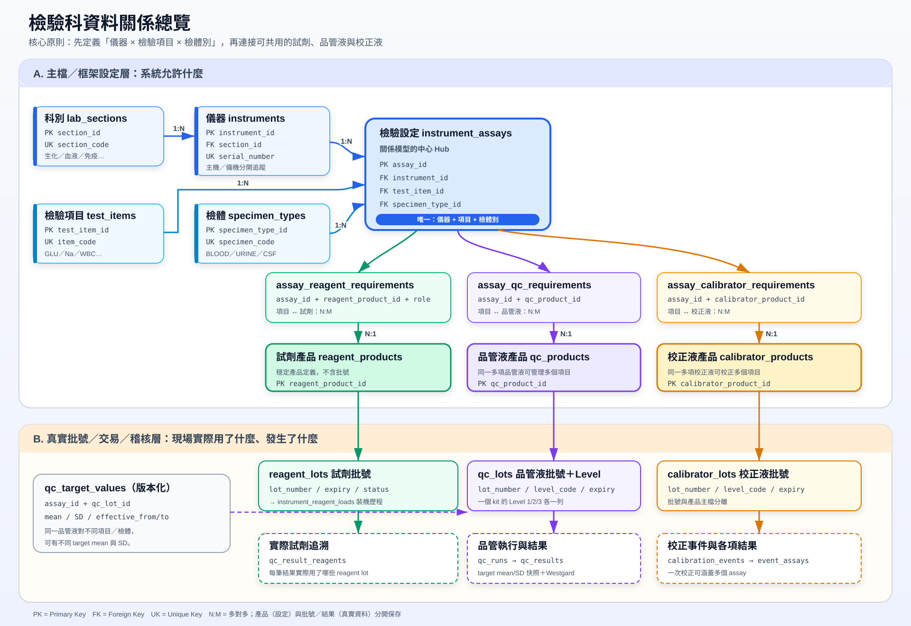

# 檢驗科儀器、項目、品管液、校正液與試劑資料庫設計

本目錄提供一套可作為新系統起點的 **MySQL 8.0.16+** 參考設計：

- [關係總覽圖](lab_relationships.svg)
- [MySQL 初始化腳本](init_db.sql)

> `init_db.sql` 是「全新環境初始化」腳本，會先刪除同名 view/table；請勿直接對正式資料庫執行。正式上線應改用版本化 migration，並先備份與演練還原。

## 一張圖看完整關係



圖中的核心不是單獨的「檢驗項目」，而是 `instrument_assays`（檢驗設定）：

```text
檢驗設定 = 儀器 × 檢驗項目 × 檢體別
```

例如 GLU / BLOOD 與 GLU / URINE 是兩筆不同設定；GLU / BLOOD 在兩台儀器上執行，也會是兩筆不同設定。每筆設定再透過三張 mapping table，分別連到可用的試劑、品管液與校正液產品。

## 四個條件如何被滿足

| 需求 | 資料模型 |
|---|---|
| 項目有 BLOOD / URINE / CSF 等不同檢體 | `instrument_assays` 對 `specimen_types` 是 N:1；唯一鍵為 `(instrument_id, test_item_id, specimen_type_id)` |
| 多個項目共用同一品管液 | `assay_qc_requirements` 實作 assay 與 `qc_products` 的 N:M |
| 多個項目共用同一試劑 | `assay_reagent_requirements` 實作 assay 與 `reagent_products` 的 N:M |
| 多個項目共用同一校正液 | `assay_calibrator_requirements` 實作 assay 與 `calibrator_products` 的 N:M |

N:M 中介表不是多餘的：除了表達共用關係，它還能保存 `required`、`priority`、試劑角色與備註。未來換產品時，改 mapping 即可，不必修改每一筆歷史結果。

## 分層設計

### 1. 主檔／框架設定層

這一層回答「系統允許什麼」：

| Table | 用途 |
|---|---|
| `lab_sections` | 生化、血液、免疫等科別／工作區 |
| `instruments` | 儀器實體，以序號唯一識別 |
| `specimen_types` | BLOOD、URINE、CSF 等檢體字典 |
| `test_items` | GLU、Na、WBC 等全院共用項目字典 |
| `instrument_assays` | 儀器 × 項目 × 檢體的可執行檢驗設定，整個模型的中心 |
| `reagent_products` | 試劑產品定義，不放批號 |
| `qc_products` | 品管液產品定義，不放批號與濃度層級 |
| `calibrator_products` | 校正液產品定義，不放批號 |
| `assay_reagent_requirements` | assay ↔ 試劑產品 N:M；可標主試劑、稀釋液、清洗液等角色 |
| `assay_qc_requirements` | assay ↔ 品管液產品 N:M |
| `assay_calibrator_requirements` | assay ↔ 校正液產品 N:M |

### 2. 批號／庫存實體層

這一層回答「現場現在拿到哪一批」：

| Table | 用途 |
|---|---|
| `reagent_lots` | 試劑批號、效期、開封日與狀態 |
| `qc_lots` | 品管液批號與 Level；同一 kit 的 Level 1/2/3 各一列 |
| `calibrator_lots` | 校正液批號、Level、效期與狀態 |
| `qc_target_values` | 每個 assay × QC lot/level 的 mean、SD、允收區間及生效期間 |
| `instrument_reagent_loads` | 哪一批試劑在何時裝到哪台儀器、哪個位置 |

### 3. 真實交易／稽核層

這一層回答「實際發生了什麼」：

| Table | 用途 |
|---|---|
| `qc_runs` | 一次品管執行的 header；一支多項品管液可產生多個結果 |
| `qc_results` | 每個 assay 的量測值、mean/SD 快照、Z-score 與 Westgard 結果 |
| `qc_result_reagents` | 該筆結果實際使用的試劑批號，可為多筆 |
| `calibration_events` | 一次校正事件的 header |
| `calibration_event_assays` | 此次校正涵蓋哪些 assay，以及各項 Pass/Fail |
| `calibration_event_reagents` | 每個校正項目實際使用的試劑批號 |

`qc_results` 刻意保存 `target_mean_snapshot`、`target_sd_snapshot` 與 `unit_snapshot`。主檔日後變更時，歷史判讀仍能重現，這是醫療品質稽核很重要的「當時值快照」。

## 建立資料庫

預設資料庫名為 `laboratory_qaqc`。若要改名，修改 SQL 最前面的 `CREATE DATABASE` 與 `USE`：

```bash
mysql --default-character-set=utf8mb4 -u root -p < init_db.sql
```

腳本會預先建立 BLOOD、URINE、CSF 與五個示範科別。日期時間建議由應用程式統一寫入 UTC，顯示時再轉成本地時區。

## 建議寫入順序

1. 建立科別、儀器、檢體別與檢驗項目。
2. 建立 `instrument_assays`，明確指定儀器、項目、檢體別。
3. 建立三種產品主檔，寫入三張 requirement mapping。
4. 收貨時新增 lot；不要為換批號另建 product。
5. 為 assay + QC lot/level 建立 `qc_target_values`。
6. 執行品管時先寫 `qc_runs`，再以同一 transaction 寫 `qc_results` 與 `qc_result_reagents`。
7. 校正時以同一 transaction 寫 `calibration_events`、`calibration_event_assays` 與實際試劑批號。

批號、結果與事件原則上不應 hard delete；主檔停用請使用 `active = FALSE`，批號則變更 `lot_status`。SQL 採多數 `ON DELETE RESTRICT`，讓誤刪在 DB 層直接失敗。

## 常用查詢

### 查一台儀器的項目／檢體與可用產品

```sql
SELECT
    v.serial_number,
    v.item_code,
    v.specimen_code,
    rp.product_name AS reagent,
    qp.product_name AS qc,
    cp.product_name AS calibrator
FROM v_assay_catalog AS v
LEFT JOIN assay_reagent_requirements AS ar
       ON ar.assay_id = v.assay_id
LEFT JOIN reagent_products AS rp
       ON rp.reagent_product_id = ar.reagent_product_id
LEFT JOIN assay_qc_requirements AS aq
       ON aq.assay_id = v.assay_id
LEFT JOIN qc_products AS qp
       ON qp.qc_product_id = aq.qc_product_id
LEFT JOIN assay_calibrator_requirements AS ac
       ON ac.assay_id = v.assay_id
LEFT JOIN calibrator_products AS cp
       ON cp.calibrator_product_id = ac.calibrator_product_id
WHERE v.serial_number = 'YOUR-SERIAL-NUMBER'
ORDER BY v.item_code, v.specimen_code;
```

這個查詢會把三組 N:M 關係交叉展開；如果一個 assay 各有多個 reagent、QC、calibrator，列數會相乘。API 回傳時更建議分三個子查詢，或各自聚合成 JSON array，避免笛卡兒式放大。

### 查某項目一段期間的品管趨勢

```sql
SELECT
    d.run_at,
    d.serial_number,
    d.item_code,
    d.specimen_code,
    d.qc_lot_number,
    d.qc_level,
    d.result_value,
    d.z_score,
    d.result_status
FROM v_qc_result_detail AS d
WHERE d.serial_number = 'YOUR-SERIAL-NUMBER'
  AND d.item_code = 'GLU'
  AND d.specimen_code = 'BLOOD'
  AND d.run_at >= '2026-01-01 00:00:00'
  AND d.run_at <  '2026-02-01 00:00:00'
ORDER BY d.run_at;
```

## 將框架設定與真實資料分開的優點

- **避免重複與拼字漂移**：結果表只存 FK，不會同時出現 `Urine`、`URINE`、`Urin`。
- **共用關係自然**：同一品管液、試劑或校正液只建一次，再由 mapping 連到多個 assay。
- **換批不改設定**：product 是穩定定義，lot 是實體批號；換批只新增 lot，歷史不會被覆蓋。
- **稽核與重現較可靠**：結果保留 lot、target version 及 mean/SD 快照，可說明當時為何判為 Pass/Fail。
- **權限可以分層**：少數管理者能改 assay／mapping，一般操作員只能新增 lot、run、result。
- **交易表較窄**：大量結果不用重複存長產品名稱，索引與 buffer pool 更有效率。

## 缺點與代價

- **表與 JOIN 變多**：讀取完整名稱或物料資訊時要 JOIN；API／報表 SQL 較長。
- **寫入流程較嚴格**：必須先有主檔、mapping、lot 才能寫結果，匯入舊資料時尤其需要資料清理。
- **跨表規則增加**：修改設定與切換批號必須包在 transaction 中，否則可能留下半套狀態。
- **版本管理需要紀律**：不可直接覆寫已被歷史資料引用的意義；應停用、建立新版本或設定生效期間。
- **ORM 容易產生 N+1**：逐筆查名稱會很慢，需 eager loading、批次查詢或 read view。
- **刪除較不方便**：`ON DELETE RESTRICT` 是刻意的安全設計，但測試資料清除與主檔合併會多幾個步驟。

## 會不會因為表多而 SEEK 很慢？

通常不會。MySQL 的成本主要取決於「掃描多少列、JOIN 是否有索引、過濾條件選擇性與查詢寫法」，不是資料表數量本身。此 schema 採 `BIGINT` PK、所有 FK 對應索引，並為常用路徑建立複合索引，例如：

- `instrument_assays(test_item_id, specimen_type_id, active)`
- `qc_runs(instrument_id, run_at)`
- `qc_results(assay_id, qc_run_id)`
- 各 mapping table 另有「反方向」索引，避免只能由 assay 往產品查。

需要注意的真正風險是：

1. 不加條件一次展開三組 N:M，會造成結果列相乘。
2. 對索引欄位套函數，例如 `DATE(run_at) = ...`，可能使 range index 失效；應改寫成 `>=` 與 `<`。
3. 把核心關係做成 EAV（`entity_id / key / value`）或大量 JSON，雖然 table 少，型別、FK、唯一性與 range query 都會變差。
4. 數千萬筆 QC 結果後，dashboard 不應每次掃原始歷史；可加入日／月彙總表、讀取快取或歸檔策略。

上線前應針對真實資料量執行 `EXPLAIN ANALYZE`。若常用查詢與目前索引不同，再依觀測結果加索引；不要為每個欄位預先建索引，因為索引也會增加寫入與儲存成本。

## 正規化設定表與「萬用設定表」的界線

推薦像本設計一樣，把核心醫療關係放在有型別、有 FK 的正規化 tables。只有低風險、低查詢需求、常變動的附加參數（例如廠牌特有顯示設定），才考慮放入 `JSON` 設定欄；不要把儀器、檢體、品管、試劑與校正關係全部塞進 EAV/JSON。

如果有大量報表需求，可另外建立 read model／materialized summary（MySQL 可用排程彙總表模擬），但它應由上述正規化資料產生，而不是取代 source of truth。

## 實作時仍需由服務層處理

SQL 已用複合 FK 驗證「結果屬於同一儀器」、「QC／校正／試劑產品確實被該 assay 允許」以及「lot 確實屬於該 product」。下列事項仍建議由 service transaction 處理：

- lot 已過期、隔離或召回時禁止使用；
- 同一產品切換新舊 lot 的工作流程與人員授權；
- Westgard 的跨 run 連續規則；
- `qc_results` 的 target snapshot 必須由 `qc_target_values` 在寫入當下複製；
- 稽核軌跡、電子簽核、備份、還原與資料保留年限。

